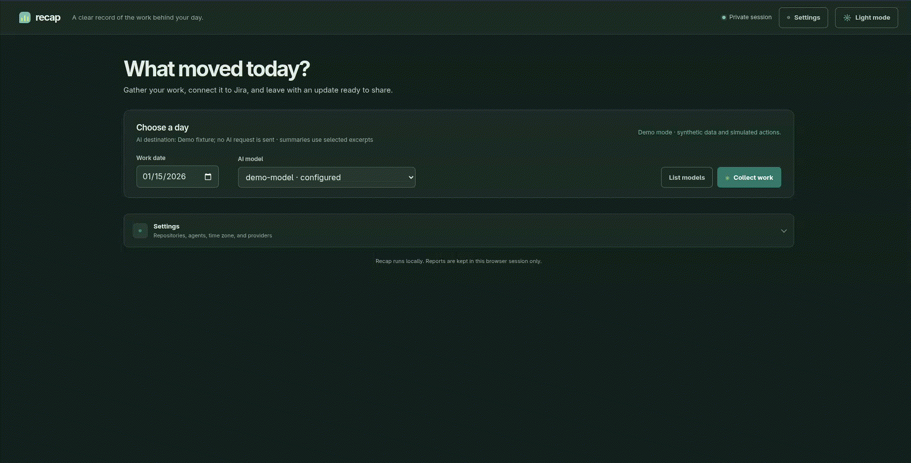
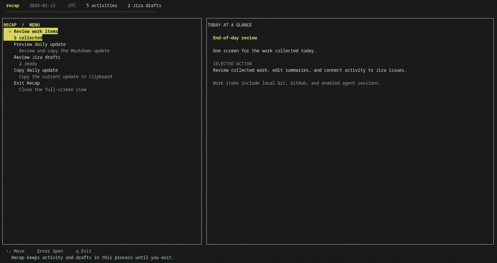

# Recap

Recap prepares an end-of-day engineering update from GitHub activity, local Git repositories, coding-agent sessions, and Jira. Run it when you need an update, review the collected work, and copy the result or explicitly approve Jira comments for posting.

## Why Recap? Because “I reviewed that PR” shouldn’t be a memory test.

A busy day can mean reviewing a dozen pull requests, making small fixes across several repositories, and following up on unrelated issues. By the end of the day, it is easy to forget the review, the quick fix, or the work that never had a Jira key.

Recap gathers those scattered signals, helps connect them to Jira, and turns them into one daily update you can review, edit, and copy. The small work counts, too.

### Browser



### Terminal




## How it works

Recap gathers activity for the selected date in the configured timezone: GitHub pull request reviews and updates, local Git work, enabled agent sessions, and Jira issue candidates. It groups repeated actions on the same pull request and filters low-signal events such as label changes.

One AI request summarizes the complete activity set and suggests a Jira issue when there is a suitable match. Work without a suitable Jira match stays in the daily update; you can leave it daily-only or exclude it. Review and edit the results, then copy the Markdown or plain-text update. Jira comments are separate drafts and are posted only after explicit approval.

## Requirements

- Python 3.11 or newer
- Git available on `PATH`
- Credentials for any connected services you want to use

Runtime Python dependencies are declared in `pyproject.toml` and installed by pip. This project does not need a separate `requirements.txt`.

## Install and start

From the project checkout, create a virtual environment and install Recap:

```bash
python -m venv .venv
.venv/bin/python -m pip install .
```

On Windows, use `.venv\Scripts\python.exe` instead of `.venv/bin/python` and `.venv\Scripts\recap.exe` instead of `.venv/bin/recap`.

Initialize a config file if one does not already exist, then check which file Recap will use:

```bash
.venv/bin/recap config init
.venv/bin/recap config path
```

Edit that config file as described below. Set the required credentials in your shell, then run the terminal workspace or browser UI:

```bash
export GITHUB_TOKEN='...'
export JIRA_USERNAME='your-jira-username'
export JIRA_API_TOKEN='...'
export OPENAI_API_KEY='...'

.venv/bin/recap run
# Or use the browser interface:
.venv/bin/recap ui
```

In PowerShell, set credentials and run the command:

```powershell
$env:GITHUB_TOKEN = '...'
$env:JIRA_USERNAME = 'your-jira-username'
$env:JIRA_API_TOKEN = '...'
$env:OPENAI_API_KEY = '...'
.venv\Scripts\recap.exe run
```

The browser UI serves only on loopback and opens in your default browser. Stop it with Ctrl+C.

To develop from the checkout, install the optional development tools as well:

```bash
.venv/bin/python -m pip install -e ".[dev]"
.venv/bin/python -m pre_commit install
.venv/bin/python -m pre_commit run --all-files
.venv/bin/python -m pytest -q
.venv/bin/python -m ruff check src tests scripts
.venv/bin/python -m ruff format --check src tests scripts
```

Use `.venv\Scripts\python.exe` commands on Windows. The `dev` extra in `pyproject.toml` installs pre-commit, pytest, and Ruff alongside runtime dependencies. Installing pre-commit adds the repository hooks to local Git commits. The first run downloads the pinned hook environments.

The hooks check whitespace, YAML and TOML syntax, merge conflicts, private keys, Ruff lint and formatting, and Gitleaks. `pre-commit run --all-files` runs on tracked files without staging them; untracked files are not included.

GitHub Actions runs every configured pre-commit hook and the unit tests on pushes and pull requests. A hook or test failure fails the workflow.

## Configuration

Recap selects configuration in this order:

1. A path passed with `--config PATH` before the command.
2. `config.toml` in the directory where you launch Recap, if it exists.
3. The operating system's standard user config path.

`recap config path` prints the selected path. `recap config init` creates that file if it does not exist and reports an error if it already exists. The checked-in [`config.example.toml`](config.example.toml) is a template; copy it to `config.toml` in your launch directory if you want a project-local config. Keep credentials in environment variables, not in either file.

Example settings:

```toml
repo_roots = ["~/projects"]
repo_excludes = ["node_modules", ".venv", "venv", "vendor", "build"]
agent_sources = ["codex", "claude", "cursor"]
timezone = "local"
jira_base_url = "https://your-site.atlassian.net"
jira_recent_days = 30
issue_provider = "jira"
ai_provider = "openai_responses"
ai_base_url = "https://api.openai.com/v1"
ai_model = "your-model-id"
ai_max_output_tokens = 4096
comment_template = "concise"

[templates]
concise = "{date} update for {issue_key} — {issue_title}\n\n{items}\n\n{links}"
detailed = "Work completed on {date}:\n\n{items}\n\nReferences:\n{links}"
```

Recap recursively searches each `repo_roots` directory for Git repositories and worktrees. A root can itself be a repository or contain repositories. Hidden directories are skipped; `repo_excludes` lists additional directory names to skip. Recap does not search your entire home directory unless you add it as a root. Run `recap repos` to inspect the result. Repeat `--repo-root DIR` to override configured roots for one invocation.

Use `timezone = "local"` to follow the machine's timezone, or set an IANA timezone such as `Etc/UTC`. The default reporting date is today in the selected timezone. Abbreviations such as `IST` are rejected because they can be ambiguous.

`agent_sources` controls which supported local agent-session sources Recap reads. Templates may use `{date}`, `{issue_key}`, `{issue_title}`, `{items}`, `{links}`, and scalar values from `[custom]`. Config files only accept non-secret settings; keys containing `token`, `password`, `secret`, `api_key`, or `credential` are rejected.

## Credentials and AI providers

Set credentials in your shell environment, not in the config file. The GitHub token needs access to the repositories you want included. Jira credentials need permission to read assigned issues and post comments. If GitHub or Jira credentials are missing, Recap warns and skips that source.

The default `openai_responses` provider calls the configured API root's `/responses` endpoint with `store = false`, the standard service tier, and low reasoning effort. It reads `OPENAI_API_KEY` and also accepts `RECAP_AI_API_KEY`. Other remote AI endpoints use `RECAP_AI_API_KEY`; Recap does not send an OpenAI key to another host. A local Chat Completions endpoint can use `ai_provider = "chat_completions"`; no API key is required for `localhost`. Set `ai_model` to an ID supported by your endpoint. The UI can list available models when the endpoint supports model discovery.

For compatibility, configs using `ai_provider = "openai_compatible"` remain supported: an `api.openai.com` base URL uses Responses, while other base URLs use Chat Completions. New configs should use an explicit provider name.

For each non-empty report, Recap sends one AI request containing the collected activity and Jira candidates. It sends activity titles and selected coding-agent final-answer excerpts, not full tool transcripts. If the model or configured output limit cannot handle the complete report, Recap reports the error.

## Commands

```bash
.venv/bin/recap --help
.venv/bin/recap run
.venv/bin/recap run --days-ago 1
.venv/bin/recap run --date 2026-01-15 --tz Etc/UTC
.venv/bin/recap run --repo-root ~/projects --model your-model-id
.venv/bin/recap ui
.venv/bin/recap models
.venv/bin/recap repos
.venv/bin/recap config --help
.venv/bin/recap config init --help
.venv/bin/recap config path --help
```

Put `--config PATH` before the command, for example: `.venv/bin/recap --config ./config.toml run`. `run` opens the full-screen terminal workspace when attached to a terminal. Use the arrow keys and Enter to review items, edit summaries, change Jira matches, preview the update, and copy it. **Back**, Esc, or Backspace returns to the previous view; q exits. Jira comments require a separate explicit approval. With output redirected, `run` prints the update and ticket drafts without opening the workspace or posting comments.

`ui` starts the browser interface. `models` lists IDs offered by the configured AI endpoint. `repos` lists repositories discovered beneath configured roots. See each command's `--help` output for all options.

## Privacy and limitations

Recap saves only non-secret settings. Activity, session excerpts, AI results, Jira assignments, and drafts remain in process memory and are discarded when the command exits or the UI server stops. The browser UI stores only the theme preference and settings-pane mode in browser storage; report data is not saved there. Clipboard copying happens only when requested. Recap does not run a background collector. GitHub activity can be delayed or truncated, and GitLab is not currently supported.

## Code structure

- `src/recap/web/` contains the HTML, CSS, and JavaScript for the loopback UI.
- `providers.py` defines the activity-provider contract and registers GitHub, local Git, and agent-session collectors.
- `ai_provider.py` defines the AI-provider contract and Responses and Chat Completions implementations.
- `issue_provider.py` defines the issue-tracker contract and Jira implementation.
- `report.py` contains the shared report service and renderer used by the CLI and UI.
